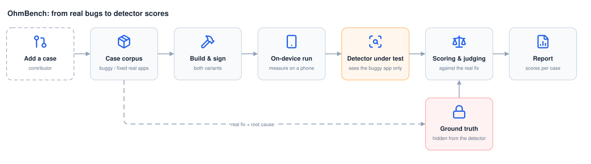

# OhmBench

OhmBench is a benchmark of real performance bugs in open-source HarmonyOS (ArkTS) apps.
Each case is a pair of app builds: one with the bug and one with the fix.
A tool under test gets the symptom and runtime data from the buggy build.
It must find the code that causes the cost and propose a repair.
OhmBench scores the answer against the known root cause and the real fix.
It is for teams that build or compare performance-diagnosis tools for HarmonyOS, such as profilers, analyzers and LLM agents.

Today the benchmark has **23 included cases from 8 apps** (20 strong, 3 weak) and 1 excluded case.
The full list is in [docs/cases.md](docs/cases.md).



The diagram source is [docs/architecture.drawio](docs/architecture.drawio); open it in [diagrams.net](https://app.diagrams.net).

## News

- **2026-11** The HapRay evaluation checklist moved to [docs/hapray-eval.md](docs/hapray-eval.md) (`9941f2d`).
- **2026-11** PR #3 merged: weak-case marking, input-data audit, mapping of cases to HapRay scenes, and batch collection and scoring tools. It closes issue #1.
- **2026-11** Three new measured cases added; one case excluded because its public backend stopped answering. The benchmark now has 23 included cases (`d31b05f`, `59b52af`).
- **2026-11** Input-data fixtures and local replay services restored in `tools/collect/fixtures/` (`9f8b553`).
- **2026-11** Two versions of the HapRay analysis skill were evaluated on the 21 cases included at the time, with three paired runs.
- **2026-11** Issue #1 opened with improvement requests for evaluating HapRay-Skill on OhmBench: weak cases, backend dependencies, scene mapping, more cases and batch scoring.
- **2026-11** Each case made self-contained as `source.patch` + `fix.patch` on a public upstream commit (`225e358`). Nine cases that failed the performance gate were removed, leaving 21 (`8a5e4e7`).
- **2026-11** Project renamed from OhmBenchmark to OhmBench (`11d4fbc`).
- **2026-11** First version: 30 candidate cases with host patches and offline tools (`2863a47`).

## Design in brief

- **Real bugs.** Every case comes from an ordinary open-source HarmonyOS app in a public repository.
  The bug sits on a path a user reaches through the UI.
- **Unfixed/fixed pairs.** Both variants are built from the same upstream commit.
  `source.patch` creates the buggy variant; `fix.patch` holds only the repair.
  The repair defines the ground truth for the location and for the fix.
- **Measured on a real phone.** A case is added only if the buggy variant costs measurably more than the fixed one, over at least three rounds per variant, with the same workload and data.
- **Blind evaluation.** The tool sees the symptom, the HapRay data and optionally the buggy source.
  It never sees the fix, the ground truth or the case metadata.
- **No weak spots hidden.** Cases with a small effect (below 1.5x) are marked `weak` and every score is also reported without them.
  Cases that can no longer run are excluded with a written reason.
- **Five layers.** Case corpus → build and sign → on-device collection → detector under test → scoring and judging.

Full rationale: [docs/design.md](docs/design.md).

## Case construction standard

A case is one directory `cases/<case-id>/` with `case.json`, `prompt.json`, `groundtruth.json`, `source.patch`, `fix.patch` and a `testcase/` folder.
[docs/case-standard.md](docs/case-standard.md) defines:

- the inclusion criteria, and which tool enforces each one;
- the required files and the directory layout;
- the `case.json` schema, with allowed values;
- the quality tiers (`strong` / `weak`) and runnability levels (`offline` / `local_service` / `public_backend`);
- the build → sign → run → verify checklist;
- the acceptance criteria for the catalog;
- the naming and versioning conventions.

`python3 tools/catalog.py check` validates every case.
`python3 tools/catalog.py docs` regenerates [docs/cases.md](docs/cases.md) from the case files.

## Evaluation protocol

1. **Select cases.** `python3 tools/catalog.py list [--scene load|memory|jank|latency] [--tier strong] [--data offline]`.
2. **Collect data on a phone** from the unfixed variant: `tools/collect/run_cases.py`.
3. **Run the tool** on one blind input directory per case: `tools/evaluate/run_hapray.py`.
4. **Score** the answers against `groundtruth.json` and `fix.patch`: `tools/evaluate/score.py`.
5. **Judge** (optional) whether the first diagnosis and repair are right: `tools/evaluate/judge.py`, with a model or a person.

Metrics:

| Metric | Meaning |
|---|---|
| `top1`, `top5` | a primary root cause is the first suspect / among the first five |
| `precision`, `recall`, `f1` | over the top-5 suspects, by the matching rules in [docs/evaluation.md](docs/evaluation.md#metrics) |
| `fix_file_hit`, `fix_hunk_hit` | the first fix edits a file / a hunk that `fix.patch` changes |
| `scene_match` | the tool analyzed the case's HapRay scene |
| `diagnosis_correct`, `repair_correct` | judge verdicts on the first suggestion |

Scores are macro averages over all selected cases, also shown for strong cases only and per HapRay scene.
A case without an answer scores zero.
Details: [docs/evaluation.md](docs/evaluation.md).
Step-by-step checklist for HapRay-Skill: [docs/hapray-eval.md](docs/hapray-eval.md).

## Quick start

Requirements:

- Python 3.10+ and git.
- HarmonyOS command-line tools (SDK 5.1.0 was used), linked at `toolchain/command-line-tools`. They provide `ohpm`, `hvigorw` and `ark_disasm`.
- Your own HarmonyOS signing certificate, profile and keystore.
- A HarmonyOS phone reachable with `hdc` (the newest reference measurements used a Pura 70 Ultra).
- [ArkAnalyzer-HapRay](https://github.com/SMAT-Lab/ArkAnalyzer-HapRay) for collection, and the tool you want to evaluate (for example [HapRay-Skill](https://gitcode.com/SMAT/HapRay-Skill) with an agent CLI).

```bash
# 1. Rebuild both source variants of every case from public upstreams
python3 tools/prepare_sources.py

# 2. Build unsigned HAPs and audit them
mkdir -p toolchain && ln -s /path/to/command-line-tools toolchain/command-line-tools
python3 tools/build_cases.py [case-id ...]
#    -> artifacts/<case-id>/{unfixed,fixed}/app-unsigned.hap; sign them yourself

# 3. Collect HapRay data from the unfixed variant on a phone
python3 tools/collect/run_cases.py captures/ --device SERIAL --prepare ./my_prepare.sh

# 4. Run the tool under test, one blind case at a time
python3 tools/evaluate/run_hapray.py captures/ runs/v1 --with-source -- \
  claude -p "$(cat tools/evaluate/agent_prompt.md)"

# 5. Score
python3 tools/evaluate/score.py runs/v1 --out results.json --md results.md
```

`my_prepare.sh CASE_ID VARIANT ROUND SERIAL` installs your signed build and restores the case's input data.
[tools/collect/prepare_browser.py](tools/collect/prepare_browser.py) is a complete example.
More on building and signing: [docs/build.md](docs/build.md).

## Infrastructure

| Path | Role |
|---|---|
| `cases/<case-id>/` | the cases ([layout](docs/data.md#repository-layout)) |
| `cases/collection.yaml` | reference HapRay / hiprofiler collection configuration |
| `tools/catalog.py` | validate cases (`check`), select them (`list`), regenerate the case tables (`docs`) |
| `tools/prepare_sources.py` | clone upstream apps into `hosts/`, apply the patches, verify tree hashes |
| `tools/build_cases.py` | build unsigned HAPs for both variants with `ohpm` and `hvigorw` |
| `tools/audit_app.py` | reject benchmark code in the source and the disassembled bytecode |
| `tools/collect/run_cases.py` | batch HapRay collection on one phone |
| `tools/collect/prepare_browser.py` | example prepare hook (install + restore input data) |
| `tools/collect/fixtures/` | input-data seed scripts and local replay services |
| `tools/evaluate/run_hapray.py` | stage blind inputs and run any tool command per case |
| `tools/evaluate/agent_prompt.md` | the reference prompt for an agent with HapRay-Skill |
| `tools/evaluate/score.py` | score answers against the ground truth and `fix.patch` |
| `tools/evaluate/judge.py` | ask a model (or a person) to judge diagnosis and repair |
| `tests/` | unit tests for the catalog, scoring and batch runner |

### Adding a case

Follow [docs/case-standard.md](docs/case-standard.md).
In short: pick a real bug, write the two patches and the workload, measure the pair on a phone, write the ground truth, then run:

```bash
python3 tools/prepare_sources.py <case-id>
python3 tools/build_cases.py <case-id>
python3 tools/catalog.py docs
python3 tools/catalog.py check
python3 -m unittest discover tests
```

### Adding a detector

Any tool can be evaluated.
`run_hapray.py` runs the command after `--` once per case.
In each argument, `{input}`, `{output}` and `{case}` are replaced by the blind input directory, the output directory and the case id.
The tool must write `{output}/answer.json` with ranked suspects; the format is in [tools/evaluate/agent_prompt.md](tools/evaluate/agent_prompt.md) and [docs/evaluation.md](docs/evaluation.md#per-case-record).
`score.py` also reads HapRay-Skill's own outputs (`fix-plan.json`, `root_cause_agent_result.json`, scene reports).
A tool with another output format needs a small reader in `score.py` or a converter to `answer.json`.

## More documentation

- [Design rationale](docs/design.md)
- [Case standard](docs/case-standard.md)
- [Overview](docs/overview.md): prerequisites and what the benchmark provides
- [Data](docs/data.md): repository layout, source + patch, prompt, oracle, workload
- [Building and signing](docs/build.md)
- [Collection and evaluation standard](docs/evaluation.md)
- [Evaluating HapRay-Skill: step by step](docs/hapray-eval.md)
- [Cases](docs/cases.md): generated case tables
- [Known limitations](docs/limitations.md)
