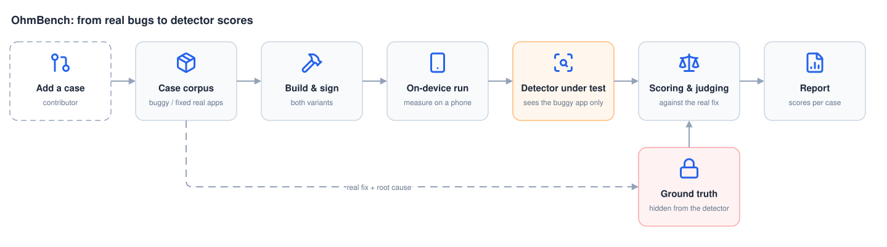

[English](README.md) | **简体中文**

# OhmBench

OhmBench 是一个性能缺陷基准，收录开源鸿蒙（ArkTS）应用中的真实性能问题。
每个用例包含同一应用的两个构建：有缺陷版和修复版。
被测工具拿到症状描述和运行时数据，需要定位引起开销的代码并给出修复。
OhmBench 用已知根因和真实修复来给答案打分。
它面向开发或对比鸿蒙性能诊断工具的团队。

目前共有 **8 个应用的 23 个有效用例**（20 个 strong，3 个 weak），另有 1 个已排除（[列表](docs/cases.md)）。



| 概念 | 对应位置 |
|---|---|
| 新增用例 | [docs/case-standard.md](docs/case-standard.md) |
| 用例库 | [`cases/<case-id>/`](cases/)、[`tools/catalog.py`](tools/catalog.py) |
| 构建与签名 | [`tools/prepare_sources.py`](tools/prepare_sources.py)、[`tools/build_cases.py`](tools/build_cases.py)、[`tools/audit_app.py`](tools/audit_app.py) |
| 真机运行与测量 | [`tools/collect/run_cases.py`](tools/collect/run_cases.py)、[`tools/collect/fixtures/`](tools/collect/fixtures/) |
| 被测检测工具 | [`tools/evaluate/run_hapray.py`](tools/evaluate/run_hapray.py)、[`agent_prompt.md`](tools/evaluate/agent_prompt.md) |
| 标准答案 | 每个用例中的 `groundtruth.json`、`fix.patch` |
| 评分与评判 | [`tools/evaluate/score.py`](tools/evaluate/score.py)、[`tools/evaluate/judge.py`](tools/evaluate/judge.py) |
| 报告 | `score.py --out results.json --md results.md` |

## 动态

- **2026-11** HapRay 评测清单移至 [docs/hapray-eval.md](docs/hapray-eval.md)（`9941f2d`）。
- **2026-11** 合并 PR #3：weak 用例标记、输入数据审计、场景映射、批量工具。关闭 issue #1。
- **2026-11** 新增 3 个用例，1 个因后端停服被排除，有效用例增至 23 个（`d31b05f`、`59b52af`）。
- **2026-11** 恢复输入数据和本地回放服务（`9f8b553`）。
- **2026-11** 在 21 个用例上评测两个版本的 HapRay skill，各做三组配对运行。
- **2026-11** 提出 issue #1，汇总 HapRay-Skill 评测的改进需求。
- **2026-11** 用例改为基于公开提交的补丁，可独立复现（`225e358`）；9 个未通过性能门槛被移除，剩余 21 个（`8a5e4e7`）。
- **2026-11** 项目由 OhmBenchmark 更名为 OhmBench（`11d4fbc`）。
- **2026-11** 首个版本：30 个候选用例（`2863a47`）。

完整记录（英文）：[docs/news.md](docs/news.md)。

## 设计思路

- **真实缺陷**：来自公开的开源应用，位于用户真实可达的路径上。
- **缺陷/修复成对**：两个版本基于同一上游提交，`fix.patch` 只包含修复。
- **真机实测**：缺陷版开销必须更高，至少测三轮。
- **盲评**：被测工具看不到修复和标准答案。
- **标出弱用例**：所有分数都另给一份不含 weak 用例的结果。

详见 [docs/design.md](docs/design.md)。

## 用例标准

每个用例是一个目录 `cases/<case-id>/`，包含元数据、提示、标准答案、两个补丁和工作负载。
[docs/case-standard.md](docs/case-standard.md) 规定了收录条件、元数据格式和验收清单。
`python3 tools/catalog.py check` 会校验全部用例。

## 评测与指标

流程：选用例、真机采集、盲态运行被测工具、评分，可选评判。
指标：`top1`/`top5`、`precision`/`recall`/`f1`、`fix_file_hit`/`fix_hunk_hit`、`scene_match` 和评判结论。
分数取宏平均，并分别给出仅 strong 用例和按 HapRay 场景的结果。
详见 [docs/evaluation.md](docs/evaluation.md)。

## 快速开始

需要 Python 3.10+、鸿蒙命令行工具、签名证书、一台手机和 HapRay（[详情](docs/overview.md#prerequisites)）。

```bash
python3 tools/prepare_sources.py && python3 tools/build_cases.py    # then sign the HAPs
python3 tools/collect/run_cases.py captures/ --device SERIAL --prepare ./my_prepare.sh
python3 tools/evaluate/run_hapray.py captures/ runs/v1 --with-source -- claude -p "$(cat tools/evaluate/agent_prompt.md)"
python3 tools/evaluate/score.py runs/v1 --out results.json --md results.md
```

完整步骤见 [docs/overview.md](docs/overview.md#end-to-end-run)。

## 参与贡献

- **新增用例**：遵循[用例标准](docs/case-standard.md#6-acceptance-criteria-for-the-catalog)。
- **接入检测工具**：任意命令行工具，只要为每个用例写出 `answer.json`（[说明](docs/evaluation.md#adding-a-detector)）。

## 文档

文档均为英文：
[概览](docs/overview.md) · [设计](docs/design.md) · [用例标准](docs/case-standard.md) · [数据](docs/data.md) · [构建与签名](docs/build.md) · [评测](docs/evaluation.md) · [HapRay-Skill 评测清单](docs/hapray-eval.md) · [用例列表](docs/cases.md) · [已知局限](docs/limitations.md)
