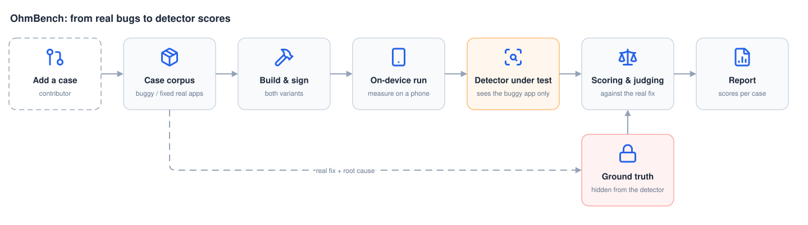

# Design rationale

This page explains why OhmBench is built the way it is.
The rules that follow from these choices are in [the case standard](case-standard.md).

## Goal

OhmBench measures how well a tool diagnoses and repairs performance bugs in HarmonyOS apps.
The tool can be a profiler, a static analyzer or an LLM agent.
It gets the symptom and the data a developer would have.
It must name the code that causes the cost and propose a fix.
OhmBench then checks the answer against a known root cause and a known repair.

## Why real bugs in open-source apps

Synthetic bugs are easy to plant and easy to find.
They do not show how a tool behaves on real code.
OhmBench therefore uses ordinary open-source HarmonyOS (ArkTS) apps from public repositories.
Each bug is a performance anti-pattern on a real user path of that app.
Examples: a database query that sorts a whole table, a list built without lazy loading, a search without debounce.
The upstream repository and the base commit are recorded in `case.json#host_app`.
Anyone can rebuild the same app from public sources.
[docs/cases.md](cases.md#host-applications) lists the nine host apps and their licences.

## The unfixed/fixed pair

Every case is a pair of app variants built from the same upstream commit.

| Variant | Content |
|---|---|
| unfixed | upstream base commit + `source.patch` (build and device adaptations, plus the bug) |
| fixed | unfixed + `fix.patch` (the repair only) |

The pair gives three things at once:

- **Ground truth for the location.** The lines that `fix.patch` changes are the root cause.
  `groundtruth.json` records them as functions, fields or constants in the unfixed source.
- **Ground truth for the repair.** `fix.patch` is a reference repair.
  A judge compares a tool's proposed fix with it.
- **Proof that the bug is real.** The same workload runs on both variants on a real phone.
  The unfixed variant must cost measurably more than the fixed one.
  This difference is the case's performance oracle.

Because `fix.patch` holds only the repair, nothing else differs between the two variants.
The measured difference is caused by the bug.

## What a case is

A case is one directory `cases/<case-id>/`.
It is self-contained: it holds patches, not app sources.

| File | Role | Who sees it |
|---|---|---|
| `prompt.json` | the symptom a user reports, the bundle and the scenario | the tool under test |
| `testcase/` | a HapRay testcase and a UI workload plan | the tool and the collector |
| `source.patch` | public upstream commit to unfixed source | the build only |
| `fix.patch` | unfixed to fixed source | the evaluator only |
| `groundtruth.json` | mechanism, root-cause locations, performance oracle and its evidence | the evaluator only |
| `case.json` | metadata: host app, source tree hashes, testcase, collection, quality, runnability, HapRay scene | the evaluator only |

The full field list is in [the case standard](case-standard.md#casejson-schema).

## Layers

The benchmark has five layers.
Each layer reads the output of the one before it.

1. **Case corpus.** `cases/` plus the generated catalog [docs/cases.md](cases.md).
   `tools/catalog.py` validates the metadata and selects cases.
2. **Build and sign.** `tools/prepare_sources.py` rebuilds both source trees from upstream and checks their git tree hashes.
   `tools/build_cases.py` builds unsigned HAPs with the HarmonyOS command-line tools.
   `tools/audit_app.py` checks the source and the disassembled bytecode for benchmark code.
   The user signs the HAPs with their own certificate.
3. **Device and collection.** The signed app runs on a real HarmonyOS phone over `hdc`.
   `tools/collect/run_cases.py` installs each case through a user hook, restores its input data and runs `hapray perf`.
   The result is a capture directory per case and round.
4. **Detector under test.** `tools/evaluate/run_hapray.py` gives the tool one blind input directory per case.
   Any command line works; HapRay-Skill driven by an agent CLI is the reference example.
5. **Evaluation.** `tools/evaluate/score.py` scores the answers against `groundtruth.json` and `fix.patch`.
   `tools/evaluate/judge.py` optionally asks a model or a person whether the diagnosis and the repair are right.

## Blind evaluation

The tool under test must not see the answer.
It may get the signed unfixed HAP, `prompt.json`, the `testcase/` files, data collected from the unfixed variant, and optionally the unfixed source without git history.
It must not get `case.json`, `groundtruth.json`, `fix.patch`, `source.patch`, the fixed variant or the reconstructed repositories.
`source.patch` is hidden because its hunks point at the modified code.
`run_hapray.py` stages only the allowed files.
`prompt.json` describes the symptom and never the cause or the fix.
The full rules are in [evaluation.md](evaluation.md#blind-input).

## Reproducibility

- **Sources.** Each variant is identified by its git tree hash (`case.json#source.<variant>.tree`).
  `prepare_sources.py` refuses a tree that does not match.
- **Builds.** HAP builds are not byte-identical across machines.
  The tree hash is the stable identity; `reference_unsigned_hap_sha256` records the hash of the reference build only.
- **Workloads.** The UI workload is a JSON plan of `setup`, `measured` and `verify` actions.
  Only `measured` is profiled.
  Both variants run the same plan with the same input data.
- **Input data.** Each case states what data it needs (`case.json#runnability`).
  Offline fixtures and local replay services ship in `tools/collect/fixtures/`.
  Public backends are avoided because they change or disappear.
- **No instrumentation.** No counters, custom traces or test hooks are compiled into the apps.
  The app under test behaves like the upstream app.

## Avoiding weak cases

A benchmark is only as good as its weakest cases.
OhmBench filters cases at several points.

- **The oracle gate.** A pair is added only if the unfixed variant exceeds the fixed one by the margin in `performance_oracle.comparison`, over at least three rounds per variant on a real device.
  Nine early candidates failed this gate and were removed (commit `8a5e4e7`).
- **The quality tier.** `tools/catalog.py` computes the median unfixed/fixed ratio of the recorded evidence.
  Below 1.5x the case is marked `weak`.
  Weak cases stay, but every score is also reported on strong cases only.
- **The runnability check.** A case that cannot run today is excluded with a written reason.
  `wanharmony_persisted_home_list_growth` was excluded when its public API stopped answering.
- **The injection audit.** A build fails if benchmark code is found in the source or the bytecode.
- **The metadata check.** `python3 tools/catalog.py check` rejects inconsistent or incomplete cases.
  The unit tests run it.

## Ground truth

`groundtruth.json` records each root cause as a code location in the unfixed source.

- `primary` locations must be found; they define recall.
- `related` locations are also touched by the fix; naming them is correct but not required.
- `aliases` are other locations accepted for the same root cause, such as the caller of a slow SQL constant.

A location match does not prove that the explanation is right.
For that, a judge reads the first suggestion beside the real mechanism and `fix.patch`.

## Scope and known gaps

The benchmark maps every case to one of HapRay's four analysis scenes: load, memory, jank and latency.
Coverage is uneven: 18 cases are load cases, 3 are memory, 2 are latency and none has a jank oracle.
Five oracles use metrics that HapRay `perf` does not report.
These and other gaps are listed in [limitations.md](limitations.md).
